  
  &nbsp;
  

 

  Still learning, always building, and caring about the small details that make a big difference. 
  On my way to becoming an <b>IT Project Manager</b> or <b>Software Engineer</b>.

 

  

 

  <picture>
    <source media="(prefers-color-scheme: dark)" srcset="https://github.com/sh4rron/sh4rron/raw/output/snake-dark.svg" />
    <source media="(prefers-color-scheme: light)" srcset="https://github.com/sh4rron/sh4rron/raw/output/snake.svg" />
    
  </picture>

